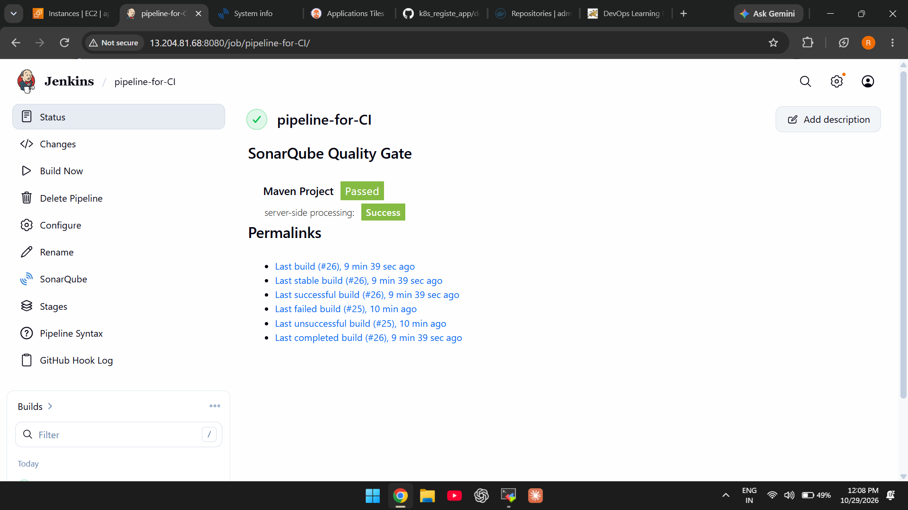
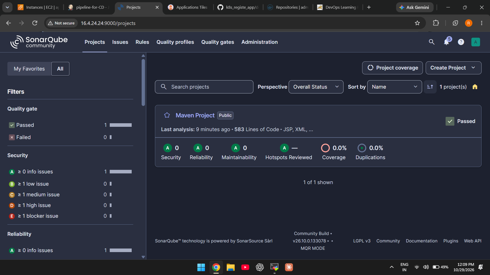
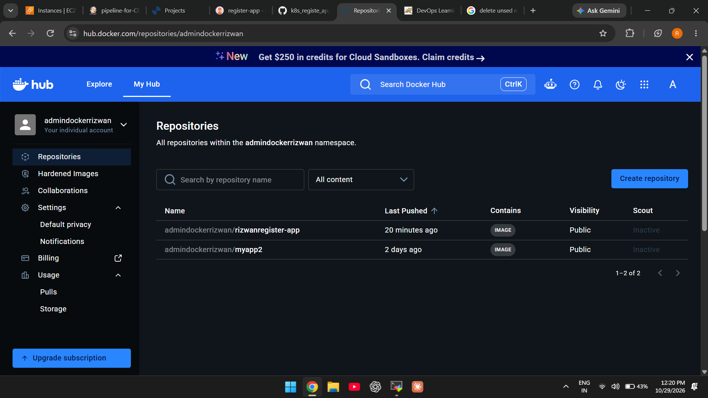

# Registration App — CI Pipeline

A Java/Maven registration application delivered through a Jenkins CI pipeline. The pipeline builds and tests the app, runs SonarQube analysis, creates and publishes a Docker image, scans the image with Trivy, and triggers the CD job.

## Repositories

- **Application + CI:** https://github.com/rizwancloud/registration_app_code
- **Kubernetes manifests + CD:** https://github.com/rizwancloud/k8s_registe_app

## CI workflow

1. Check out the application source.
2. Build and test with Maven.
3. Run SonarQube analysis and wait for the Quality Gate result.
4. Build and push the Docker image.
5. Scan the image for HIGH and CRITICAL vulnerabilities with Trivy.
6. Trigger Jenkins job `pipeline-for-CD`, passing `IMAGE_NAME` and `IMAGE_TAG`.

The image pushed by the current `Jenkinsfile` follows this format:

`admindockerrizwan/rizwanregister-app:<BUILD_NUMBER>`

## Main files

- `Jenkinsfile` — CI pipeline.
- `pom.xml` — Maven build configuration.
- `Dockerfile` — container image build instructions.
- `server/` and `webapp/` — application source/assets, as organized in this repository.

## Jenkins requirements

The Jenkins agent labelled `agent` needs Java, Maven, Docker access, Git, and Trivy. Configure the SonarQube installation in Jenkins with the name `sonarqube`, add the Docker Hub credential ID `dockerhub-credentials`, and configure the SonarQube webhook to reach Jenkins at `/sonarqube-webhook/`.

The pipeline currently uses `abortPipeline: false` for the SonarQube Quality Gate, so a failed gate does not by itself stop the pipeline. The Trivy stage is configured to fail on HIGH or CRITICAL findings.

## Project Documentation

> [!IMPORTANT]
> **Want to understand how this project was built?**
>
> Explore the complete project documentation covering infrastructure setup, Jenkins CI/CD pipelines, SonarQube, Docker, Kubernetes (Kind), Argo CD, deployment instructions, and troubleshooting.
>
> **[Read the Complete Project Documentation →](https://github.com/rizwancloud/k8s_registe_app/blob/de0e5efbd1ee430e7dae72e6eb8914f793a48f66/docs/PROJECT_DOCUMENTATION.md)**

## Project Screenshots
### Jenkins Pipeline CI Status

### SonarQube Code Quality Analysis

### ADocker Image Build and Push

**Security:** Keep real passwords and tokens in Jenkins Credentials. The `DOCKER_PASS` value in the current pipeline is a placeholder and should not be used as a real secret.
